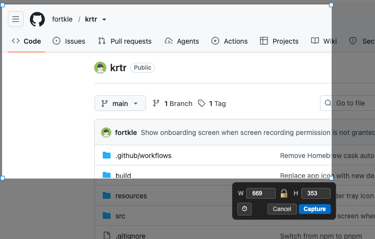

# krtr

A lightweight screenshot tool for macOS, inspired by Skitch. Capture a region or your full screen, adjust the selection, and share via drag-and-drop.

<p align="center">
  
</p>

## Install

1. Download the latest zip from [Releases](https://github.com/fortkle/krtr/releases) — pick **Apple Silicon** (M1/M2/M3/M4) or **Intel**
2. Unzip and move `krtr.app` to `/Applications`
3. Since the app is not code-signed, remove the quarantine attribute:
   ```
   xattr -cr /Applications/krtr.app
   ```
4. Open krtr — it lives in your **menu bar** (no Dock icon)
5. Grant **Screen Recording** permission when prompted (System Settings > Privacy & Security > Screen Recording)

## Usage

| Shortcut | Action |
|---|---|
| `Cmd+Shift+5` | Capture region |
| `Cmd+Shift+6` | Capture full screen |

You can also click the scissors icon in the menu bar.

### Region capture flow

1. Press `Cmd+Shift+5` — a transparent overlay appears over your live screen
2. Drag to select a region
3. Adjust the selection:
   - **Drag inside** to move
   - **Drag corners** to resize
   - Edit **width/height** numerically in the popup
   - Toggle **aspect ratio lock**
   - Use the **timer** to capture after a 5-second countdown (you can interact with the desktop during countdown)
4. Click **Capture** — the preview window opens

### Preview window

Annotate the screenshot with the toolbar at the top:

| Tool | Key | |
|---|---|---|
| Arrow | `A` | Point at something |
| Rectangle | `R` | Box an area |
| Ellipse | `O` | Circle an area |
| Mosaic | `M` | Pixelate an area to hide it |
| Crop | `C` | Drag to select, then **Apply** (default tool) |

- Pick one of the five colors, toggle the white outline, and choose one of five line thicknesses (thickness button, or keys `1`–`5`) before drawing
- Hold `Shift` while dragging to snap arrows to 45° and draw squares / circles
- Click a shape to select it: drag it to move, drag a handle to resize (arrows: drag either end), `Delete` to remove. Changing the color, outline or thickness applies to the selected shape
- `Cmd+Z` undoes the last change, `Esc` cancels the current drag or clears the selection
- Annotations are baked into the image you copy, save or drag, and survive a crop

- **Drag me** tab — drag the screenshot to any app (Slack, Finder, Mail, etc.)
- **Copy** — copy to clipboard
- **Save** — save to a file with a save dialog
- Click the **filename** to rename it before dragging or saving

## Development

```bash
pnpm install
pnpm dev          # Start dev server
pnpm build        # Production build
pnpm typecheck    # Type check
pnpm package      # Build .app
```

## License

MIT
